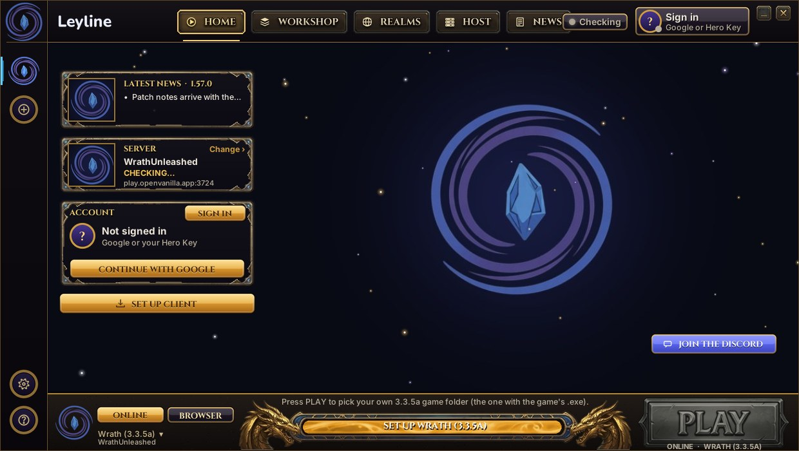

# Leyline Launcher (classic)

> **Leyline is a mod launcher and a peer-to-peer realm network.** Anyone can host their own realm in one
> click, from the browser or the desktop; players find it in the shared realm list and join, and the
> mods hub brings the addons and content packs with it. While the network grows, Leyline runs one
> temporary sample realm, the **Dalaran Hangout** (3.3.5a), and adds the new launcher's features to it
> as they land.
>
> **The new launcher, the host kit and the relay live in
> [orionopenwow/Leyline](https://github.com/orionopenwow/Leyline)** ([download](https://github.com/orionopenwow/Leyline/releases/latest)).

This repository (formerly `orionopenwow/OpenVanilla`; old links redirect) holds:

- **the classic Leyline Launcher** for 1.12.1, still installed by existing players and updating itself from
  this repository's releases. It runs on Windows (installer or zip) and from source on macOS and Linux;
- **the Leyline website** (`www/`, published with GitHub Pages at [openvanilla.app](https://openvanilla.app/)),
  including the Workshop (the mods hub's catalogue), the player manual and the files the launchers read;
- **our earlier tools and experiments**, kept in [`labs/`](labs/README.md) for later.

**Website:** [openvanilla.app](https://openvanilla.app/) · **Classic launcher:** [latest release](https://github.com/orionopenwow/Leyline-Launcher/releases/latest) · **New launcher:** [orionopenwow/Leyline](https://github.com/orionopenwow/Leyline/releases/latest) · **Discord:** [join](https://discord.gg/hVeUxYwbkr)

> **Alpha.** Things will break; please report them in [Issues](https://github.com/orionopenwow/Leyline-Launcher/issues).



## What the classic launcher does

- **Play** on a realm from the realm list, from a realm's invite link, or in the browser.
- **Play Solo:** a whole offline world with playerbots on your PC ([SPP Classics](https://github.com/celguar/spp-classics-cmangos), set up for you).
- **Host for friends:** share your Solo world over Direct or LAN, with an invite link (`launcher/p2p`).
- **Workshop:** install addons and packs from the website's catalogue with one click; our own addon suite
  (`Data/Interface/AddOns`) comes preinstalled.
- **Updates and live content:** signed update manifests and signed live content (news, flags, realm list).
- **The way forward:** since 1.57.0 the launcher shows a card that takes players to the new Leyline launcher.

You need your own copy of the game's 1.12.1 files. Leyline never ships or changes anyone else's files.

**Leyline Server** (`OpenVanilla-Server.zip` on every release) is the classic dedicated server: an SPP
Classics realm with its website, Server Studio, a GM console and Herald Autopilot, run from one window.
Run it with `Start Leyline Server.bat` (`Host a Realm.bat` in this repository).

## Repository map

```
The classic launcher, Leyline Server and the website (what the build, the release and CI use)
launcher/         the launcher (Python + Tk), frozen to OpenVanilla.exe by packaging/build_repack.py; launcher/p2p is hosting
packaging/        build_repack.py (launcher zip + installer layout), build_server.py (Leyline Server zip), installer/,
                  release_manifest.py and live_content.py (signing), workflows/ (the source of .github/workflows)
www/              the website (GitHub Pages): pages, Workshop JSON, the manual, downloads/ (version.json, live content)
Data/Interface/   our addon suite, shipped in the launcher (app/addons), and its art
workshop/         the Workshop catalogue (one .yml per addon); tools/workshop_build.py turns it into www/community/workshop
agent/            the AI starter kit the launcher copies (Settings > AI)
solo/             Play Solo's config templates and server patches
realm/classicplus the Classic+ SQL and fix-ups that Play Solo and Leyline Server apply
studio/           Server Studio (frozen into the launcher; studio_server.py runs it)
autopilot/        Herald Autopilot, the desktop app (shipped in Leyline Server)
assets/           the Leyline logo sources (assets/branding) and Leyline Server's art
art/              art masters the generators in tools/ read
*.py (root)       play_local.py, server_control.py, asset_server.py, authcheck.py, launcher_gui.py, studio_server.py,
                  openvanilla_server.py, set_realm.py: the Solo and server modules (frozen into the launcher or zipped
                  into Leyline Server; they import each other from the root)
host/ovhost       macOS/Linux hosting for Leyline Server (Host a Realm.command)
links.txt, VERSION every address the launcher and site use; the release version
devkit/           check.py (repo checks), the Lua addon sim, citations, heraldlite (built into Leyline Server), db tests,
                  UI Studio, audit.py, Dev.bat
tools/            build and content tools: prepush.py, build_manual.py, workshop_*, changelog_draft.py, modelport/,
                  the art generators (tools/gen_*.py, artkit.py: the sources of the addons' and the site's art), footage/
tests/            tests for all of the above
docs/             launcher and network notes, and the player manual's source (docs/manual -> www/manual)

labs/             earlier tools and experiments, kept for later (labs/README.md)
  openvanilla-realm/   the frozen 1.12 realm: patches, page layer, server scripts, realm tools, parked workflows
  herald/              Herald, the realm's Discord bot and autopilot API
  relay/               the Rust relay the classic launcher was built for (superseded)
  forge/               Vanilla Forge, the creator app (still built by forge.yml)
  legend/              signed character records for the Duels realm
  prototypes/          Realm Composer
```

Files players double-click: `Play Leyline Launcher.bat` / `.command` (the launcher from source; `Play Open Vanilla.*`
forward to them for old shortcuts), `Play Solo.bat`, `Host a Realm.bat` / `.command`, `Herald Autopilot.bat`.
Creators: `labs/forge/Vanilla Forge.bat` and `tools/modelport/Model_Porter.bat`.

## Run it from source

- Windows: double-click `Play Leyline Launcher.bat` (Python 3.10+).
- macOS / Linux: `Play Leyline Launcher.command` or `sh play-open-vanilla.sh`.

## Check, build and release

```
python3 devkit/check.py --strict        # repo checks: addons, patch-Z, json/yaml, js, shell, python, versions, game data
python3 -m pytest -q tests              # the test suite (the GUI tests skip without a display; run them under xvfb-run)
python3 tools/prepush.py                # rebuild generated files before a push (dev\Ship.bat runs it)
python3 packaging/build_repack.py --no-engine --launcher-dir DIR    # assemble the launcher zip locally
python3 packaging/build_server.py --version X.Y.Z                    # the Leyline Server zip
```

- **Release:** run `dev\Release.bat X.Y.Z` on the maintainer's PC. It sets `VERSION` (keep `launcher/version.json`
  the same: `check.py` fails otherwise), makes sure `CHANGELOG.md` has a `## New in X.Y.Z` section
  (`tools/changelog_draft.py`) and tags `vX.Y.Z`; `.github/workflows/release.yml`
  runs the checks and tests, builds `OpenVanilla.exe`, the installer and Leyline Server on Windows, signs the
  update manifest with `OPENVANILLA_MANIFEST_KEY` and publishes the GitHub Release. Installed launchers update
  from the newest release. See [docs/LAUNCHER.md](docs/LAUNCHER.md).
- **Website:** a push to `main` that changes `www/` goes live through `pages.yml`. Live content
  (`www/downloads/live.src.json`) is signed by the same workflow.
- **Workflows:** edit `packaging/workflows/*.yml`; `dev\Ship.bat` copies them into `.github/workflows`. The two
  copies must stay identical.

File names keep the old name where changing them would break installs and links (`OpenVanilla.exe`,
`OpenVanilla-Setup-<v>.exe`, `OpenVanilla_<v>_Win64.zip`, `OpenVanilla-Server.zip`, `%LOCALAPPDATA%\OpenVanilla`);
see [BRAND.md](BRAND.md).

## Credits

The classic launcher's engine is built on [benilla](https://github.com/samwhosung/benilla) (MIT / Apache-2.0).
Play Solo and Leyline Server run [CMaNGOS](https://github.com/cmangos) and its [playerbots](https://github.com/cmangos/playerbots)
through [SPP Classics](https://github.com/celguar/spp-classics-cmangos). Fonts: [Nunito](https://fonts.google.com/specimen/Nunito),
[Cinzel](https://fonts.google.com/specimen/Cinzel) and [Marcellus](https://fonts.google.com/specimen/Marcellus) (OFL).

## Legal

World of Warcraft and Blizzard Entertainment are trademarks or registered trademarks of Blizzard Entertainment, Inc. Leyline is an independent fan project, not affiliated with or endorsed by Blizzard Entertainment. No Blizzard game files are distributed with this software; players use their own game data.

<br>

<p align="center">
  
  <br>
  <sub>Made by Orion ❤️</sub>
</p>
