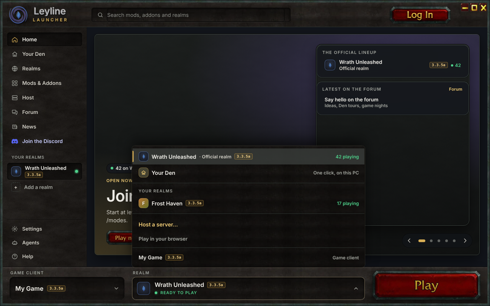
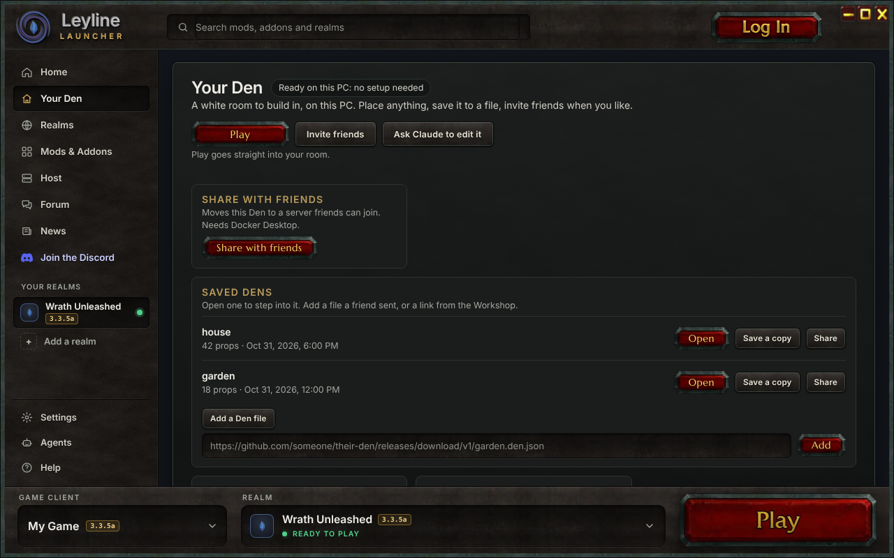
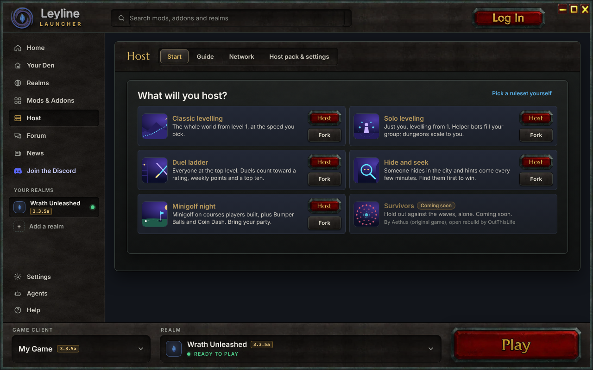
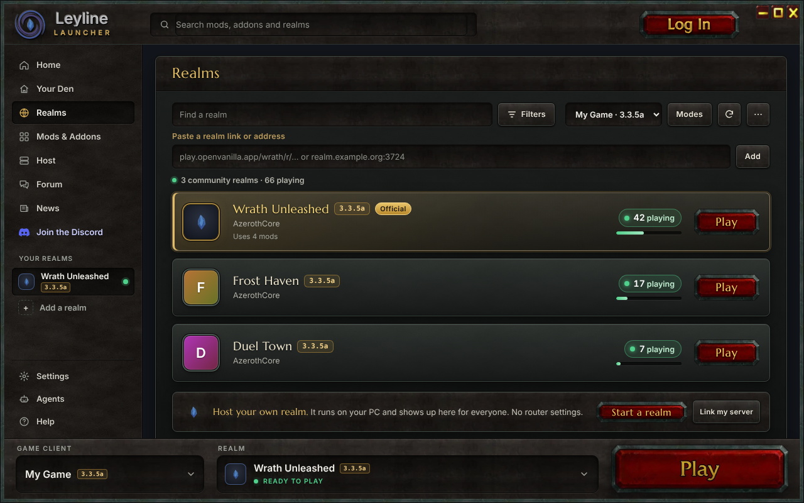

# Leyline

Leyline is a **mod launcher** and a **peer-to-peer realm network** for classic game clients.

- **Host a realm in one click**, from the browser or the desktop launcher. It runs on your own PC (Docker is
  the only thing it needs) and is listed for everyone on the Leyline realm list. No port forwarding: your realm
  talks out to a Leyline relay, players connect to the relay, and nobody sees your home address.
- **Mods and addons hub**: find, install, update and share mods, addons, game modes and themes. The launcher
  installs them into your own client in one click and checks every file first.
- **Play in your browser** (nothing to install), or **with your own client**: the launcher finds the client you
  already have, points it at the realm you picked and starts it.
- **A sample realm to try**: our temporary *Wrath Unleashed* (3.3.5a) is a Leyline realm like any other, and
  it gets our client additions first.
- **Open source**, MIT licensed. No game data is in this repo: hosts extract what their realm needs from their
  own install, on their own PC, and it never leaves it.

## The launcher

<!-- TODO(owner): this section's words, your voice -->


The play bar at the bottom of every page is the whole play flow: pick a realm, press **Play**.

- **Wrath Unleashed**, the official realm, is picked for you.
- **Your Den** is your own room to build in, on your PC: one click and you're in. Its page has **Invite friends** and
  **Ask Claude to edit it** (your own Claude builds with you, and every change waits for your OK).
- **Your realms** lists the realms you host and the ones you played on, once there are any.
- **Host a server…** opens the Host page's templates: pick one and host it in one click, then invite friends.
- **Play in your browser** needs nothing installed.

Under them is the game client the realm plays with: the launcher picks the one of the version the realm needs, and
its list adds another game folder. **Realms** lists every realm on the network.

| Your Den | Host from a template | Realms |
|---|---|---|
|  |  |  |

## Quick start: host a realm

From the browser: sign in on the Leyline site, press **Host a realm**, choose a name and house rules, and run
the one-click setup it gives you. From the desktop launcher: open **Host**.

Or by hand. macOS or Linux, with Docker running:

```sh
git clone https://github.com/orionopenwow/Leyline.git
cd Leyline/hosting/kit
bash leyline host        # a few questions the first time; safe to run again
bash leyline status      # your invite or join link
```

Windows: double-click `hosting/kit/Host a Leyline realm.bat`. Full guide: `hosting/INSTALL-OPERATE.md`.
The host kit runs 3.3.5a realms (AzerothCore) and, with its profiles, 1.12.1 and 2.4.3 realms too.

To play on a realm, open its join link (`https://relay.<domain>/join/<realm id>`) and follow the page, or pick
it on the launcher's **Realms** page.

## Run the tests

```sh
cd hosting/tests && python3 -m unittest discover -s . -p 'test_*.py'
```

A few tests read files that only the WrathUnleashed repo has (realm profiles, CI workflows, its control
panel); run those there.

## Layout

| Path | What it is |
|---|---|
| `hosting/relay/` | the relay: tunnels for hosts, the join page, the realm listing, per-IP limits |
| `hosting/kit/` | the host kit: the `leyline` command, host scripts, Docker compose |
| `hosting/kit/tools/` | the host agent, setup and self-check (`wuhost`), the shared network code (`wunet`) |
| `hosting/discord/` | the Discord bridge |
| `hosting/tests/` | tests for all of the above |
| `realm/custom/lua_scripts/` | the realm-side scripts the Leyline window and the Discord bridge talk to |
| `stream/fui-web/.../Leyline.lua` | the in-game Leyline window (`/leyline`); it runs inside the WrathUnleashed UI addon |
| `stream/links.py` | short share links for realms, hangouts, queues, mods and players |
| `stream/www-files/art/` | the Leyline art and display font (SIL OFL 1.1) |
| `mods/SPEC.md` | the mod package format |
| `docs/leyline/` | the Leyline docs: play, mods, publishing, hosting, launcher, Hero Key, other servers, commands |
| `stream/playmodes.json` | the game-mode catalog the launcher builds in |
| `stream/modepacks.json` | the mode templates (realms anyone can host and fork) the launcher builds in |
| `stream/loadouts.json` | the loadout templates (approved catalog ids only) the launcher's Host page checks against |
| `launcher/` | the Leyline desktop launcher (Windows, macOS, Linux): clients, mods, realms, hosting. Build steps in `launcher/README.md` |

The Mods & Workshop panel (`ModsPanel.lua`) uses the rest of the WrathUnleashed UI addon, so it stays in
WrathUnleashed; the in-game window here opens from it.

## Where this comes from

This repo is copied from [WrathUnleashed](https://github.com/orionopenwow/WrathUnleashed) by its
`tools/leyline-repo/export.py`. Send changes there: anything changed only here is replaced on the next copy.

- WrathUnleashed: https://github.com/orionopenwow/WrathUnleashed
- The mod format and template: https://github.com/orionopenwow/WrathUnleashed/tree/main/mods

## License

MIT (see `LICENSE`). Third-party parts and their licenses: `THIRD-PARTY-NOTICES.md`.
